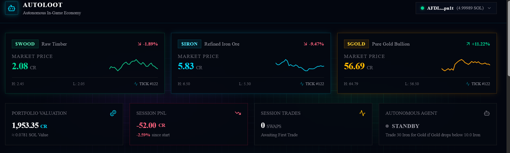
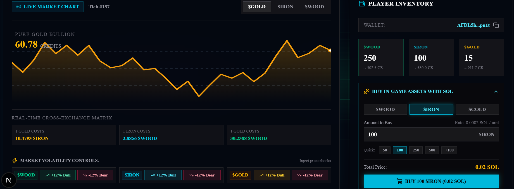
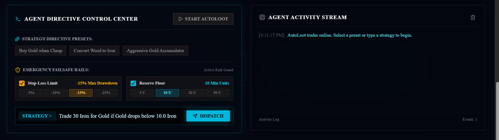
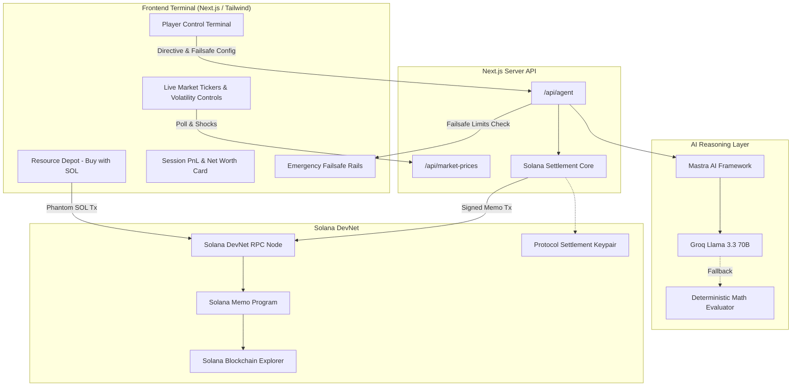

# AutoLoot — Autonomous In-Game Economy

> **AI-Managed In-Game Economist on Solana DevNet**  
> *Built for the MLH Solana Hackathon*

[](https://explorer.solana.com/?cluster=devnet)
[](https://nextjs.org/)
[](https://mastra.ai/)
[](https://groq.com/)
[](https://vitest.dev/)

---

## Overview

In traditional Web2 games, players spend hours farming, crafting, and monitoring trade boards, or their assets remain locked in static, centralized databases. When in-game resources become real Web3 tokens on Solana, players need autonomous tools to optimize their inventories without staying glued to trading terminals or signing dozens of repetitive wallet popups.

**AutoLoot** is an autonomous AI in-game economist that executes natural-language trading strategies for in-game commodities (`$WOOD`, `$IRON`, `$GOLD`) on Solana DevNet. Players set plain-English directives (e.g., *"Trade 30 Iron for Gold if Gold drops below 10 Iron"*), and AutoLoot continuously evaluates market conditions, manages risk failsafes, and settles atomic transactions directly on-chain with verified Solana transaction hashes.



---

## Interface Highlights

| Live Market Telemetry & Shocks | Autonomous Directives & Risk Rails |
| :---: | :---: |
|  |  |
| *Real-time tick sparklines, cross-rate matrix, and instant volatility shock controls.* | *Natural language directive terminal, strategy presets, and emergency risk rails.* |

---

## Key Features

- **Natural Language Strategy Engine:** Powered by Mastra and Groq Llama 3.3 70B with deterministic heuristic fallback for zero-latency execution.
- **Zero-Popup Background Autonomous Execution:** Executes scheduled trade evaluations and settles transactions on Solana DevNet automatically without disrupting the gameplay experience with browser wallet popups.
- **Real-Time Dynamic Market Engine:** Simulated live commodity economy with tick updates every 5 seconds, dynamic cross-rate matrices, and interactive volatility shock triggers.
- **Session PnL & Net Worth Analytics:** Real-time tracking of portfolio valuation (Credits and SOL equivalent), session profit/loss percentage, trade counts, and win rates.
- **Interactive Resource Depot:** Dynamic calculator allowing players to purchase custom quantities of `$WOOD`, `$IRON`, and `$GOLD` using DevNet SOL with Phantom.
- **Emergency Failsafe Rails:**
  - **Emergency Circuit Breaker:** Instant manual killswitch halting all autonomous operations.
  - **Max Drawdown Stop-Loss:** Automatically pauses trading if session drawdown breaches user-selected risk thresholds (`-5%`, `-10%`, `-15%`, `-25%`).
  - **Reserve Floor Guard:** Prevents inventory depletion by ensuring minimum commodity reserve units (`5 U`, `10 U`, `20 U`, `50 U`) are preserved.
- **Verifiable On-Chain Ledger:** Every transaction broadcasts directly to Solana DevNet with direct links to the Solana Explorer.

---

## System Architecture



---

## Architecture Decision Records (ADRs)

AutoLoot adheres to documented architectural standards to guarantee security, verifiable execution, and deterministic state transitions.

| Record | Title | Core Decision 
| :--- | :--- | :--- |
| [**ADR-0001**](docs/adr/0001-autonomous-execution-and-session-key-custody.md) | Autonomous Execution & Session Custody  | Decouple manual Phantom authorization from background trading by utilizing an ephemeral server-side protocol signer, eliminating disruptive browser popups while preserving cryptographic proofs. |
| [**ADR-0002**](docs/adr/0002-atomic-swap-settlement.md) | Atomic Swap Settlement Engine | Execute inventory updates atomically with real on-chain Solana Memo program broadcasts on DevNet, ensuring verifiable transactions with 1-second finality. |
| [**ADR-0003**](docs/adr/0003-continuous-agent-monitoring-loop.md) | Continuous Agent Monitoring Loop |  Run client-orchestrated 5-second tick polling with Groq Llama 3.3 70B reasoning and an instant deterministic math fallback, ensuring continuous uptime and zero missed trades. |

---

## Tech Stack

| Layer | Technologies |
| :--- | :--- |
| **Framework** | Next.js 16.4.3 (Turbopack, App Router) |
| **Styling & UI** | Tailwind CSS, Lucide Icons, Sonner Toasts |
| **Solana Web3** | `@solana/kit`, `@solana/kit-plugin-wallet`, `@solana/web3.js` |
| **AI Agent** | Mastra AI (`@mastra/core`), Groq SDK (Llama 3.3 70B Versatile) |
| **Testing** | Vitest, TypeScript (strict mode) |
| **Target Network** | Solana DevNet (`https://api.devnet.solana.com`) |

---

## Quickstart Guide

### Prerequisites
- Node.js 20+
- pnpm (`npm install -g pnpm`)
- Solana CLI (optional, for local keypair management)

### 1. Clone & Install
```bash
git clone https://github.com/henryanomah/auto-loot.git
cd auto-loot
cd app
pnpm install
```

### 2. Configure Environment Variables
Create `.env.local` inside the `app/` directory:
```env

GROQ_API_KEY=your_groq_api_key_here

# Solana DevNet RPC
NEXT_PUBLIC_SOLANA_RPC=https://api.devnet.solana.com
```

### 3. Run Development Server
```bash
pnpm dev
```
Open [http://localhost:3000](http://localhost:3000) in your browser.

### 4. Run Test Suite
```bash
pnpm test
```
Executes all 25 unit tests across the market engine, AI evaluator, session key custody, on-chain settlement, PnL analytics, and failsafe engines.

### 5. Build for Production
```bash
pnpm build
```

---

## Hackathon Judging Criteria Alignment

| Criteria | AutoLoot Implementation |
| :--- | :--- |
| **Solana Integration** | Real on-chain DevNet transaction broadcast for every autonomous swap via the Solana Memo program, interactive Phantom purchases, and instant Explorer verification. |
| **AI Innovation** | Uses Mastra and Groq Llama 3.3 70B to parse ambiguous player directives into structured mathematical conditions, evaluate live tick cross-rates, and execute atomic trades. |
| **Zero-Friction UX** | Solves the primary pain point of Web3 gaming by eliminating repetitive browser wallet popups during automated execution loops while maintaining player custody and emergency circuit breakers. |
| **Engineering Rigor** | 25 passing unit tests, zero TypeScript errors, clean modular separation of concerns, and full defensive error handling. |

---


